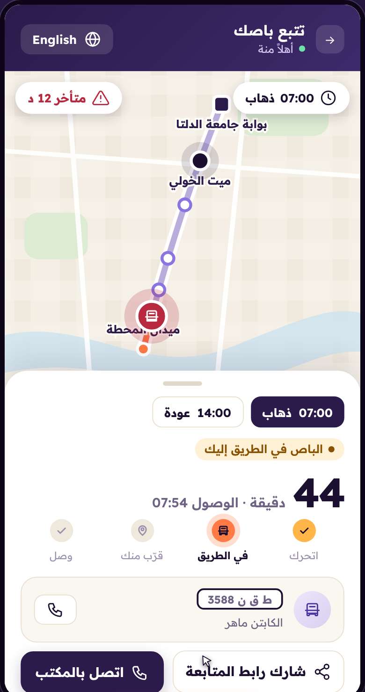
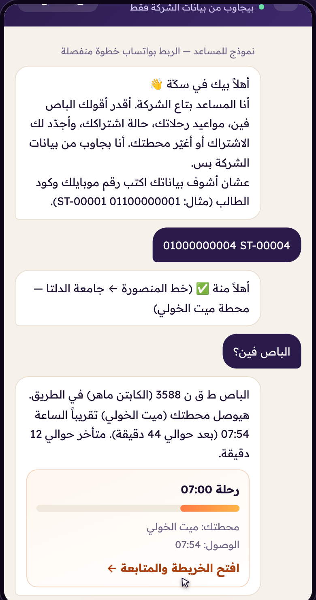
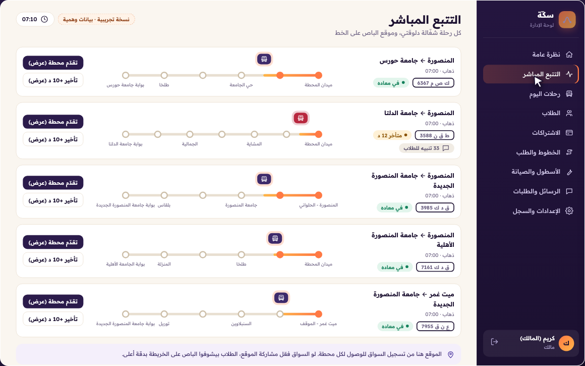

# سكّة · Sekka — operations hub for university student-transport companies

> **Know where the bus is — and let the company run itself.**
> A portfolio project: a demo of what a bus company that carries university students could run on. All data is **fictional** and the app labels itself as a demo.

Students board from fixed pickup stops, pay per term and ride to Horus, Delta, New Mansoura and Mansoura Ahlia universities (to-campus trips 07:00 / 08:00 / 10:00, return trips 13:00 / 14:00 / 15:00 / 16:00). Sekka puts the whole operation in one place.

| For | What they get |
|---|---|
| **Students** | An assistant (Arabic + English) that answers *where is my bus*, trip times, subscription status, renews, changes a stop, reports an absence or a complaint — and a private **live tracking page like Uber**: map, moving bus, driver first name, plate, ETA to *their* stop. |
| **Dispatcher** | Live board of every running trip, delay button that notifies each affected student, demand-based bus distribution, fleet health. |
| **Accountant** | Subscriptions by state (active / ending / awaiting payment), payments, cashbox. |
| **Owner** | A daily report built automatically from company data, revenue (owner-only), settings and the audit log. |
| **Driver** | A private link per trip: start, "arrived at stop", mark boarding by student code, optional live location. |

<p align="center">
  
  
</p>
<p align="center"></p>

## The six modules

1. **Student assistant** — rule-based (not an LLM, on purpose): Arabic normalisation, intent rules, multi-step flows with confirmation. It verifies identity first and answers only from the database.
2. **Renewals & reminders** — expiry, reminders at 14 / 7 / 1 days, a weekly nudge after the grace period, payment follow-up. Idempotent: running them twice sends nothing twice.
3. **Bus distribution from demand** — expected riders per line/slot are forecast from the same weekday over the last 8 weeks; the planner assigns the smallest bus that fits, avoids double-booking buses and drivers (database exclusion constraints), and puts risky buses last.
4. **Predictive maintenance** — a 0–100 risk score per bus with plain-language reasons (service km, brake-wear trend → days to the safety limit, oil, tyres, engine temperature, faults since last service, breakdowns). An urgent bus automatically gets a work order and alerts the owner.
5. **Daily owner report** — generated from the data, queued once a day, never twice.
6. **Confidential-data protection** — see [SECURITY.md](SECURITY.md): row-level security with no API policies, access only through role-checked functions, masked phones for the dispatcher, rate-limited student verification, private tokens, and an audit log.

## Live demo (opens in the browser, nothing to install)

**Live demo: _add your Vercel link here_** — the whole company runs *inside the page*: the project's real SQL (row-level security, role-checked functions, planning, maintenance, automations) executes in Postgres compiled to WebAssembly (PGlite), so there is no server, every visitor gets a private fresh copy, and refreshing resets it. First visit downloads about 12 MB, then it is cached. Use the **Demo tour** button to jump between the student, driver and staff views.

How it is built: `npm run build:web-demo` snapshots the seeded database (`dev/build-snapshot.mjs`), and in the browser `src/demo/` loads it behind a small Supabase-compatible handler (`dev/mock-core.mjs`). The production app talks to a real Supabase project instead.

## Run it locally (no account needed)

```bash
npm install
npm run demo          # builds, then serves the app + a Supabase-compatible API on http://localhost:4173
```

The demo runs the project's **real SQL** inside PGlite (Postgres in WebAssembly) and a small PostgREST/GoTrue-style mock, so nothing leaves your machine. It starts at 07:10 on the nearest operating day with trips already running (the Delta trip is 12 minutes late).

- Staff: `owner@demo.sekka.test`, `dispatch@demo.sekka.test`, `accounts@demo.sekka.test` — password `demo1234` (or use the quick buttons on the login page)
- Student assistant: phone `01100000001`, code `ST-00001` (or `01000000004` / `ST-00004` to follow the late Delta trip)
- In the demo, *Trips* has a **demo clock** and the *Live* page has **Advance a stop / +10 min delay** buttons so you can watch the student's map move.

## Tests

```bash
npm test              # database (137 checks) + assistant (56 checks)
npm run test:e2e      # browser test (32 checks) — needs `npm run demo` running
```

- **Database**: confidentiality/RLS, verification and rate limit, roles and masking, audit, planning, maintenance, automations, payments, tracking and delay alerts, simulator, requests, report, weekly nudge.
- **Assistant**: the real engine against the real SQL — understanding, verification, grounded answers, flows, and "never leaks another student's data".
- **End-to-end (Playwright)**: student chat → tracking page, role-restricted staff navigation, masked phones, delay alert reaching the outbox, driver link, no console errors.

## Using it for real

See [supabase/README.md](supabase/README.md). Three things are intentionally **not** connected in the demo, and the honest scope matters:

- **WhatsApp**: the assistant is a web chat. Messages the automations create are queued in `outbox`; sending them over WhatsApp needs a WhatsApp Business API account and a small server function.
- **Live GPS**: needs the driver's phone to share its location (supported by the driver page). Without it, position comes from stop check-ins.
- **Scheduling**: call `staff_run_automations()` from a scheduled job (pg_cron) in production.

## Stack

Vite · React 18 · TypeScript · react-router · plain CSS with logical properties (true RTL/LTR) · Supabase (Auth, Postgres, RLS, SQL functions) · Readex Pro font bundled locally · map drawn in SVG (swap in real map tiles for production).

## Layout

```
src/           app (pages/, pages/staff/, assistant/ = nlu + engine, components/, lib/)
supabase/      migration, fictional company seed, sample-data seed
tests/         db/, assistant/, e2e/
dev/           local demo server, Supabase mock, video recorder (stage page + record script)
```

Built by Ahmed Abdelaziz. MIT licence.

---

## بالعربي — ملخص

**سكّة** نظام تشغيل لشركات نقل طلاب الجامعات: الطالب يعرف الباص فين (زي أوبر)، والاشتراكات بتتجدد وتتذكّر لوحدها، والباصات بتتوزع حسب الطلب، والصيانة بتتنبّأ قبل العطل، والمالك بيوصله تقرير يومي، وبيانات الطلاب محمية بصلاحيات وسجل. كل البيانات وهمية والنسخة التجريبية مكتوب عليها كده. الشات مساعد تلقائي على الويب؛ الربط بواتساب خطوة منفصلة محتاجة حساب WhatsApp Business.
